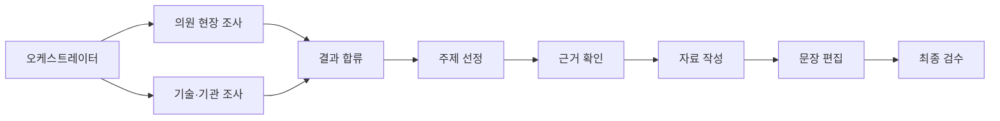

# 조사 실행과 기록 확인

조사는 LangGraph의 실제 노드·병렬 분기·합류로 실행한다. 의원 현장 조사와 기술·기관 조사는 서로의 결과를 기다리지 않고 진행한다. 두 결과를 모은 뒤 선정·근거 확인·작성·문장 편집·최종 검수를 순서대로 실행한다.



두 조사 에이전트의 완료 순서가 바뀌어도 출처 번호는 일정하다. 모델 호출은 최대 7회, 웹 도구 작업은 최대 24회다. 뒤 단계가 앞 결과에 의존하면 병렬 실행하지 않는다. 자동 유료 재시도나 재시작 후 자동 재개는 설정하지 않았다. 기존 작업 관리기는 계정별 요청 중복과 수집 한도를 관리하고, 조사 내부의 실행 순서는 LangGraph가 관리한다.

## 화면에서 보기

‘주제 둘러보기’의 개인 조사 작업 또는 ‘새 소식’의 수집 기록에서 **조사 과정 보기**를 누른다. 단계별 소요 시간·토큰·실패 내용·검색어·열람 주소·작성/편집 결과를 확인할 수 있다. 실제 지시와 입력·응답은 ‘상세 요청·응답’에서 펼친다. 기록 새로고침은 저장된 기록만 읽으며 조사나 과금 호출을 다시 시작하지 않는다.

기록은 이 버전으로 실행한 공개 조사부터 남는다. 이전 실행의 중간 입력은 복원하지 않는다. 개인 조사 기록은 본인만 볼 수 있으며, 공유 수집 기록은 로그인한 사용자가 볼 수 있다. 회사 자료를 넣는 브로셔 작성·수정은 기록 대상이 아니다.

## LangSmith 연결

로컬 기록은 `.local-data/traces.sqlite3`에 저장된다. LangSmith 설정이 없어도 화면과 조회 도구를 사용할 수 있다. 클라우드 전송은 프로젝트의 `.env.local`에 기존 키와 설정을 넣고 `LANGSMITH_TRACING=true`로 켜야 동작한다. 키를 채팅이나 Git에 넣지 않는다.

새 Agent 기반 워크스페이스에서는 다음을 설정한다.

```dotenv
LANGSMITH_TRACING=true
LANGSMITH_API_KEY=로컬에서_설정
LANGSMITH_AGENT_ID=LangSmith에서_만든_Agent_ID
LANGSMITH_AGENT_ENVIRONMENT=local
```

Project 기반 워크스페이스라면 Agent 설정 두 개 대신 `LANGSMITH_PROJECT=clinic-brief-research`를 사용한다. 두 목적지를 동시에 설정하지 않는다. US 외 지역 워크스페이스는 해당 `LANGSMITH_ENDPOINT`도 설정한다. [현재 LangSmith 설정 안내](https://docs.langchain.com/langsmith/observability-quickstart).

전송하는 것은 정제된 공개 조사 기록이다. 인증 헤더·키·HTTP 오류 본문·모델 내부 reasoning은 제외한다. LangGraph의 자동 원문 전송은 끄고, 공식 LangSmith SDK의 실행 트리에 정제한 호출을 연결한다. 서버에서 해당 실행을 다시 조회해 존재를 확인한 경우에만 화면에 LangSmith 링크를 제공한다. 새 기록의 반영이 지연되면 제한된 횟수로 조회만 다시 하고, 여전히 보이지 않으면 확인되지 않은 상태로 남긴다. 모델 요청이나 전송을 반복하지 않는다. 클라우드 전송 실패 때문에 생성 결과가 사라지지 않으며, 로컬 기록에는 전송 상태가 별도로 남는다.

조회와 링크 확인은 SmithDB v2 API를 사용한다. 현재 스레드 기반 실행에 맞춰 공식 동기 `Langsmith` 클라이언트를 사용하며, 새 SDK의 자동 재시도는 끈다. 프로젝트명을 UUID로 확인하거나 Agent의 연결 프로젝트를 조회한다. Agent 목적지 조회를 지원하지 않는 서버에서도 로컬 생성 결과는 보존한다.

이미 저장된 실행으로 연결을 확인하려면 아래 도구를 사용한다. 실행 UUID는 LangSmith에서 확인할 수 있다. `--project-id`를 생략하면 현재 설정된 목적지를 조회한다.

```sh
.venv/bin/python scripts/verify_langsmith.py --run-id "기존 실행 UUID"
```

이 도구는 기존 실행·링크·하위 실행 수만 읽는다. 새 모델 요청이나 클라우드 기록을 만들지 않으며 로컬 DB도 변경하지 않는다. `direct_child_count`는 바로 아래 실행 수, `descendant_count`는 그 아래 모든 실행 수다. 결과에 원문 입력·응답·키를 출력하지 않는다. [전환 및 검증 기록](verification/langsmith-v2-migration-2026-11-08.md).

## 에이전트가 기록 읽기

`scripts/trace_mcp.py`는 로컬 운영자용 stdio MCP 서버다. 쓰기·재실행·삭제 도구는 없으며 SQLite도 읽기 전용으로 연다.

| 도구 | 용도 |
|---|---|
| `list_research_runs` | 최근 조사 실행 찾기 |
| `get_research_run` | 단계·오류·도구 호출·사용량 확인 |
| `get_research_call` | 특정 단계의 실제 입력과 응답 확인 |
| `compare_research_runs` | 입력·지시 해시, 모델, 시간과 사용량 비교 |

이 프로젝트의 로컬 `.codex/config.toml`에 `clinic-brief-traces`를 등록했다. 현재 대화에 도구가 나타나지 않으면 Codex의 MCP 서버 설정에서 다시 연결한 뒤 사용한다. 프로젝트 MCP는 신뢰한 프로젝트에 적용된다. [Codex MCP 설정](https://learn.chatgpt.com/docs/extend/mcp?surface=cli).

다른 환경에서 등록할 때는 그 환경의 절대 경로를 사용한다.

```sh
codex mcp add clinic-brief-traces -- /프로젝트/절대경로/.venv/bin/python /프로젝트/절대경로/scripts/trace_mcp.py
```

## 기록의 범위

- 입력과 지시의 해시는 실제 전체 요청 기준이다. 표시/저장되는 내용은 정제하고 호출별 입력·응답을 각각 최대 100KB로 제한한다. 생략이 있으면 기록에 표시하므로, 생략된 기록으로 원래 입력을 완전히 재현했다고 주장하지 않는다.
- 도구 기록은 API가 반환한 search/open/find 정보다. API가 주지 않는 도구별 실행 시간이나 전체 페이지 본문을 만들어 보여주지 않는다.
- 토큰은 API가 보고한 값만 합산한다. 알 수 없는 사용량을 0이나 추정 청구액으로 표시하지 않는다.
- 기록 저장에 문제가 생겨도 완료된 생성 결과는 보존하고 기록 누락 안내를 남긴다. 실제 생성 실패를 성공으로 바꾸지는 않는다.
- 개인 조사/작업 삭제 시 해당 로컬 기록도 삭제한다. 이미 전송한 LangSmith 기록은 별도 서비스의 보관·삭제 설정에 따른다.

설치: `uv pip install --python .venv/bin/python -r requirements.txt`. 현재 검증한 직접 의존성은 LangGraph 1.2.20, LangSmith 0.14.17, MCP 1.30.0이다.
